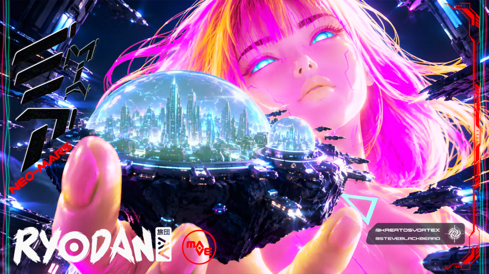

# RYODAN-ART-CONTEST by Ethernium
> **4K Ultra-Fidelity Sovereign Audio-Reactive Web Visualizer Engine**  
> *Contest Entry by Blackbeard // Ethernium Sovereign Web*

<div align="center">
  <a href="https://nullalabs.github.io/RYODAN-ART-CONTEST/?autoplay=1" title="Click Play to Launch 4K Studio with Audio">
    
  </a>
</div>

🌐 **Live Interactive 4K Studio (Click to Play with Music):**  
👉 **[▶️ PLAY RYODAN-ART-CONTEST // 4K SOVEREIGN AUDIO-REACTIVE STUDIO](https://nullalabs.github.io/RYODAN-ART-CONTEST/?autoplay=1)**  
⚡ **Mirror Direct Tunnel:** **[RYODAN-ART-CONTEST (Live Tunnel)](https://indicators-hobbies-intelligence-publishers.trycloudflare.com/?autoplay=1)**

---

## ⚡ Overview

**RYODAN-ART-CONTEST by Ethernium** is a high-performance, local-first WebGL audio visualizer engineered with Three.js and custom GLSL shaders. It renders a complete 25-layer stacked composite directly in real-time at 60–144+ FPS, maintaining full 4K UHD fidelity with zero CDN dependencies.

- **Live Web Experience (GitHub Pages CDN):** [https://nullalabs.github.io/RYODAN-ART-CONTEST/](https://nullalabs.github.io/RYODAN-ART-CONTEST/)
- **Live Web Experience (Cloudflare Mirror):** [https://indicators-hobbies-intelligence-publishers.trycloudflare.com/](https://indicators-hobbies-intelligence-publishers.trycloudflare.com/)
- **Visuals:** 25-Layer Cyberpunk PSD Stack (Diosa Cibernética, Floating City, Dome Ecosystem, Aviation Beacons, HUD, Katakana & MIA Typography, iOS Glass Credits Cartel)
- **Engine:** Ethernium Sovereign Web GLSL Architecture

---

## 💎 Key Innovations & Features

1. **Multi-Stop Chromatic Gradient Weave:**
   - Multi-phase spatial and temporal color gradients flowing diagonally and concentrically across the Goddess' hair and silhouette.
   - $C^1$ mathematical continuity: pure time-integrated Hermite transitions (`smoothstep`) with zero color snapping or phase jumping.

2. **Full-Spectrum Luminous Domes (Layers 20 & 21):**
   - 7-stop cyberpunk color spectrum (Sovereign Cyan, Deep Blue, Violet, Neon Magenta, Crimson Coral, Solar Gold, Emerald Jade).
   - Inner glass glow and diagonal specular gloss sheen sweeps.

3. **Rhythmic Skyscraper Aviation Beacons (Layer 3):**
   - Filtered red pinpoints on skyscraper tips with soft optical bloom and cadence blinking synchronized with tempo and bass transients.

4. **Clean 3D Crystal Margins:**
   - Translucent glassmorphic panels bordering the 16:9 canvas with music-reactive ambient radial auras and luminous accent seams.
   - Zero-overlap guarantee: preserves 100% of the artwork fidelity.

5. **3D Obsidian Glass Controls & iOS Cartel:**
   - Tactile 3D convex spherical play button sculpted in black obsidian glass.
   - Deep tinted stealth 3D glass cartel panel with crisp white handles (`@KREATOSVORTEX` & `@STEVEBLACKBEARD`) and rotating emblem.
   - Impossible triangle sovereign logo anchored in the bottom-right corner.

---

## 🚀 Quick Start (Local-First)

1. **Run the local HTTP server:**
   ```bash
   python web/server.py
   ```
2. **Open in browser:**
   ```
   http://127.0.0.1:8080/index.html
   ```
3. **Controls:**
   - `Space` or Click Play: Toggle audio playback and reactive loop
   - `S`: Trigger Holographic Laser Scanner
   - `F`: Toggle 4K Fullscreen mode

---

## 🏛️ Architecture

```
E:\RYODAN_STUDIO/
├── web/
│   ├── index.html                  # 3D Glassmorphic HUD & Viewport
│   ├── server.py                   # Local HTTP Server (Port 8080)
│   ├── vendor/                     # Local Three.js (Zero CDN)
│   ├── assets/                     # 25 High-Res 4K RGBA Layers & Audio
│   └── src/
│       ├── config/                 # StudioConfig (FFT bands, layers, timings)
│       ├── api/                    # AudioEngine (Web Audio Analyser & Flux)
│       ├── render/                 # Shaders & VisualizerRenderer
│       ├── ui/                     # HUD Controller & Web Margin Waves
│       └── boot/                   # App Bootstrap & Responsive Loop
├── render_webgl_gpu_4k.cjs         # Deterministic Puppeteer->FFmpeg 4K Exporter
└── capture_studio.cjs              # Headless Retina Verification Capture
```

---

## 📜 Credits & License
- **Visual Conception & Engineering:** Blackbeard (@steveblackbeard // @kreatosvortex)
- **Sovereign Engine:** Ethernium Ecosystem
